# MyResearch Portal & Workshop Management System

A comprehensive web platform connecting researchers, experts, academic institutions, and participants for research collaboration and workshop management.

## 📸 Screenshots

### Login Page
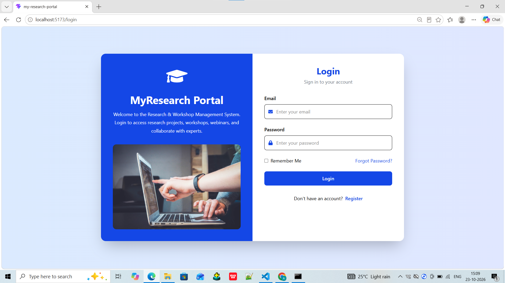

### Registration Page
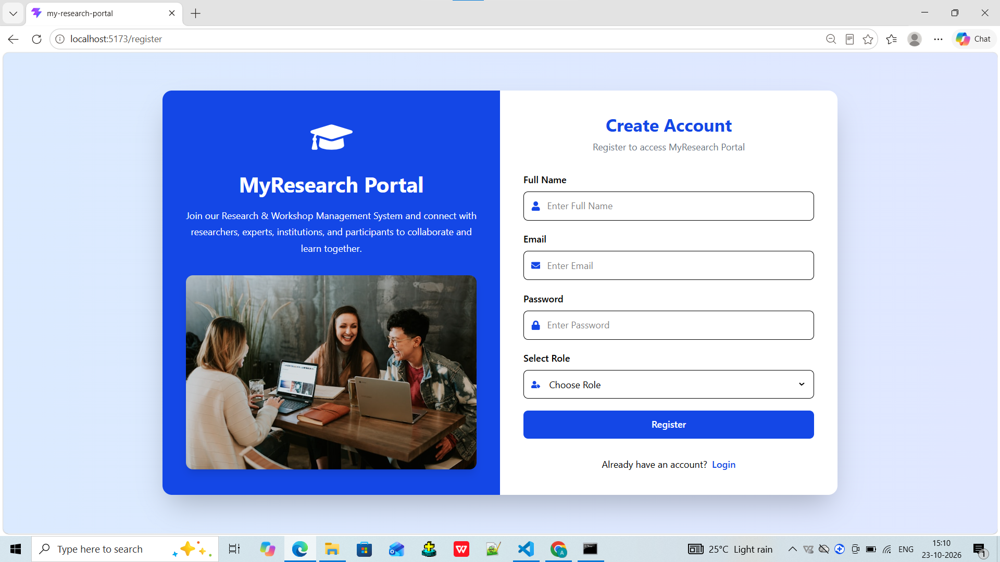

### Home Page
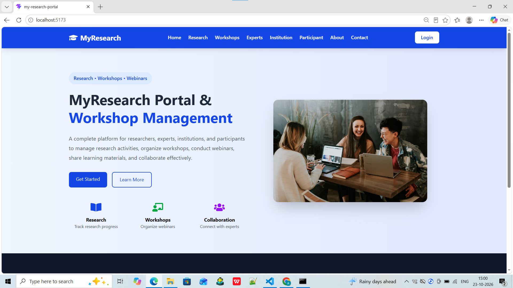

### Research Projects
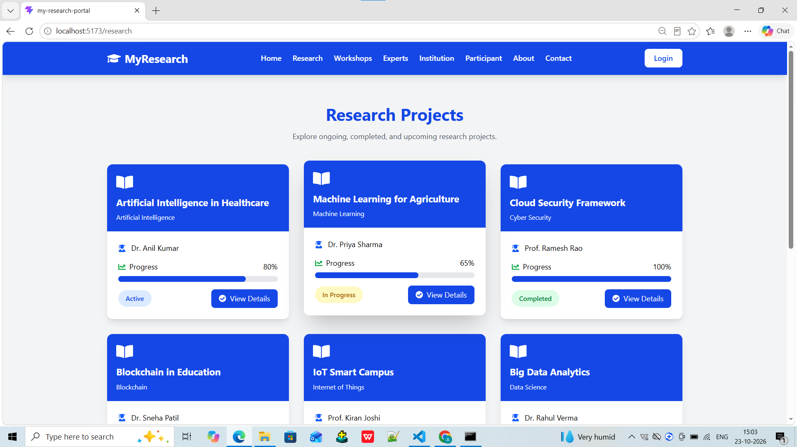

### Upcoming Workshops

### Institution Dashboard
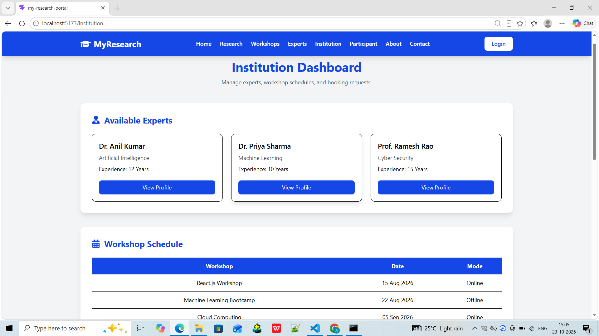

### Participant Dashboard
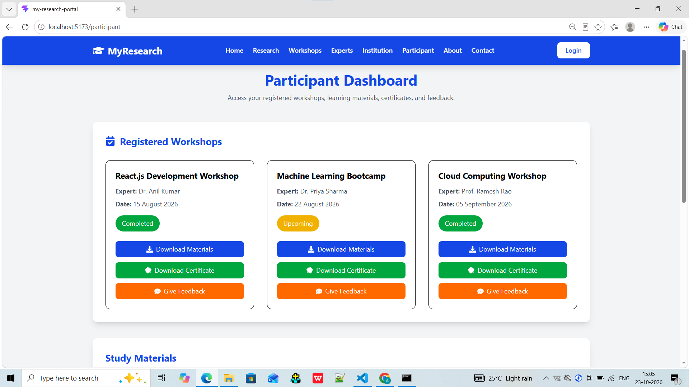

### Our Services
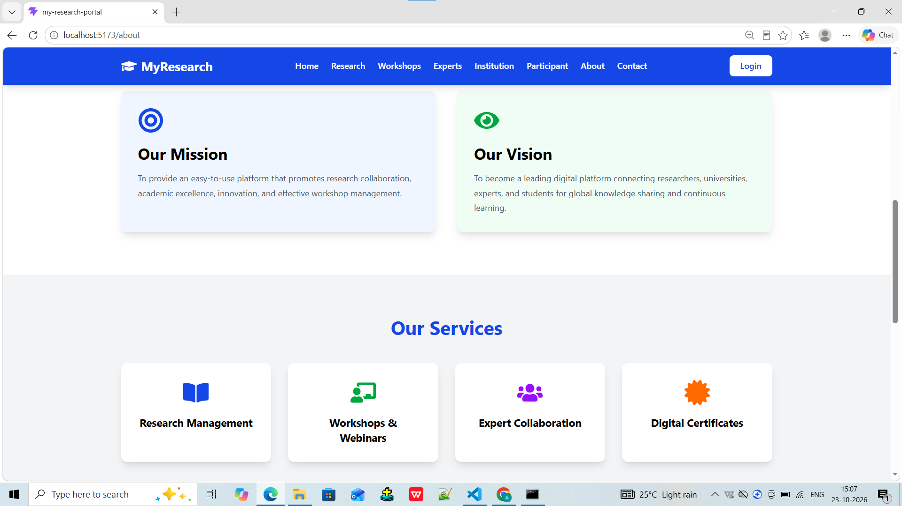

### Study Materials

### Experts
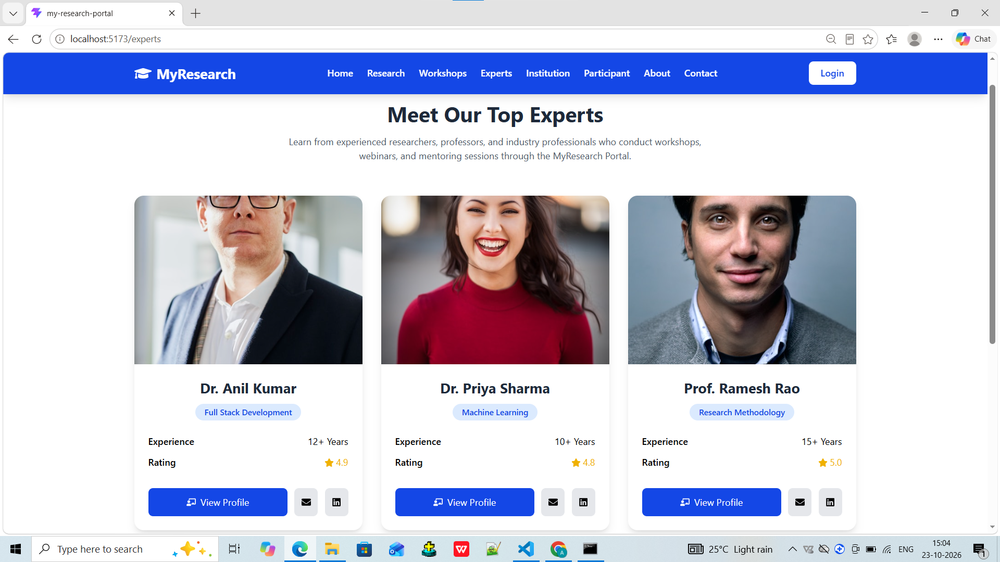

### Contact Us
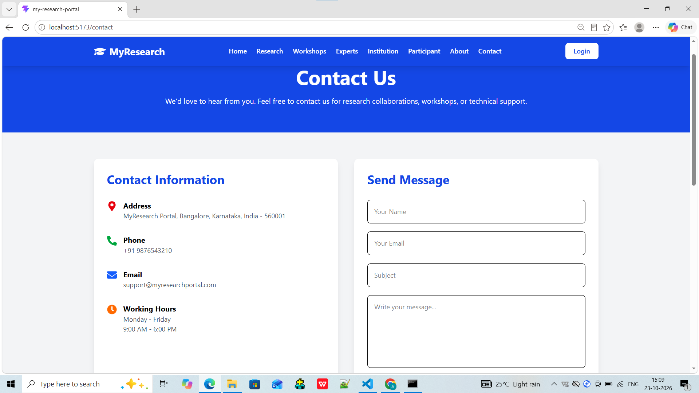

### About
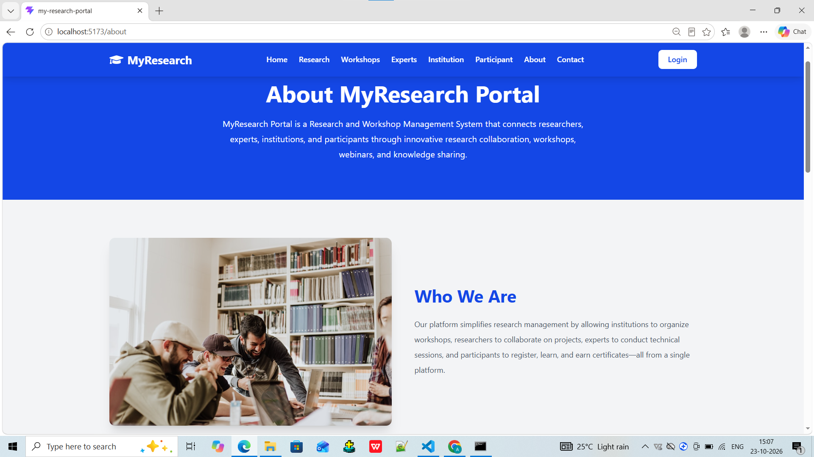

### Why Choose Us
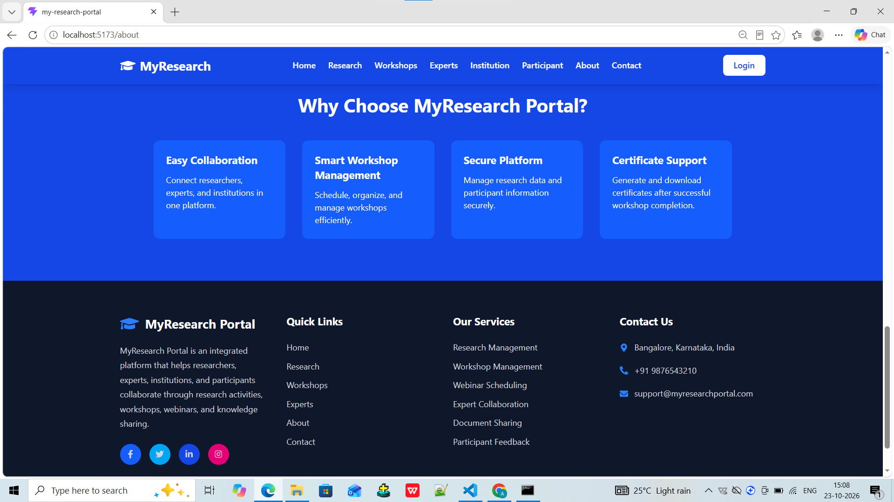